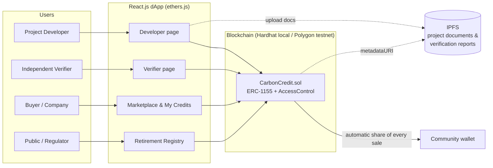
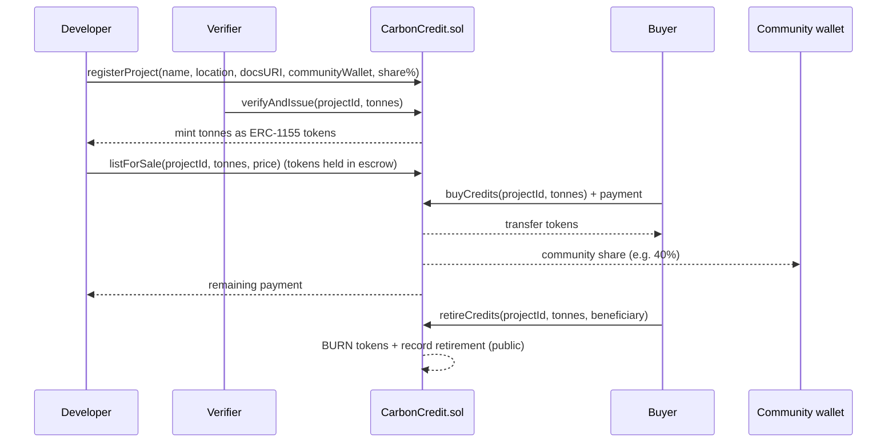

# Architecture & Blockchain Justification

## 1. System overview

## 2. Credit lifecycle

## 3. Pain point → blockchain feature mapping

| Pain point | Blockchain feature in this project | Where in code |
|---|---|---|
| **Double-counting** (same tonne claimed twice) | Retiring burns the token; a burned token can't be transferred, sold or retired again | `retireCredits()` → `_burn()` |
| **Lack of transparency** | Every project, issuance, sale and retirement is a public on-chain record and event; documents are linked by IPFS hash | `getAllProjects()`, `getAllRetirements()`, events |
| **High intermediary fees** | Buyers pay the contract directly; no broker sits between buyer and project | `buyCredits()` |
| **Communities shortchanged** | Each sale is split automatically and the community share is enforced at a platform minimum | `communityShareBps`, `minCommunityShareBps` |
| **Fake / self-certified credits** | Only accounts with the VERIFIER role can issue credits, and a developer can't verify their own project | `onlyRole(VERIFIER_ROLE)`, `SelfVerification` |
| **Over-issuance** | Each project can only be issued once | `AlreadyVerified` |

## 4. Why blockchain and not a normal database?

| Question | Traditional database | This blockchain design |
|---|---|---|
| Who controls the records? | One organisation; it can edit or delete history | No single party; history is append-only |
| Can a buyer independently check a credit? | Only if the registry owner allows it | Yes, anyone can read the chain |
| Can the same credit be sold twice? | Prevented only if the operator is honest and the systems are connected | Prevented by the protocol: burned tokens no longer exist |
| Are community payments guaranteed? | Depends on the developer paying later | Paid in the same transaction as the sale |
| What if the operator shuts down? | Records may be lost | Records remain on the network |

**Our justification in one line:** carbon markets involve many parties who don't fully trust each other (developers, verifiers, buyers, communities, government). Double-counting is the same thing as a *double-spend*, which is the problem blockchains were designed to solve.

## 5. Why ERC-1155?

- Credits from the **same project** are interchangeable, so they behave like fungible tokens.
- Credits from **different projects** are not interchangeable (a cookstove credit ≠ a forest credit).
- ERC-1155 gives each project its own token ID inside **one** contract, which is cheaper and simpler than deploying one ERC-20 per project.

## 6. On-chain vs off-chain

| On-chain (in the smart contract) | Off-chain (IPFS) |
|---|---|
| Project ID, name, location, type | Project design document (PDF) |
| Developer, verifier, community wallet | Verification/audit report |
| Issued, listed, retired totals | Photos, maps, monitoring data |
| Every sale and retirement | |

Large files are kept off-chain because storing data on a blockchain is expensive. The contract stores the **IPFS link**. IPFS links are content hashes, so if a document is changed its link changes too, which makes tampering detectable.

## 7. Limitations (be honest about these in the report)

1. **Garbage in, garbage out.** The blockchain guarantees that records aren't altered *after* they are written. It can't tell whether a verifier approved a fake project. Trust in the VERIFIER role is still required. The future-work section proposes satellite/AI checks to reduce this.
2. **One issuance per project.** Real projects issue credits every year (vintages). A production version would issue a new token ID per vintage.
3. **Admin trust.** The admin grants roles. In production this should be a multi-signature wallet or a group of regulators.
4. **Prototype scale.** Tested on a local Hardhat network. Gas costs and privacy on a public network would need more analysis.
5. **Legal recognition.** Tokens don't replace a national registry. A real system would have to integrate with Kenya's carbon registry under the Climate Change (Amendment) Act, 2023.
