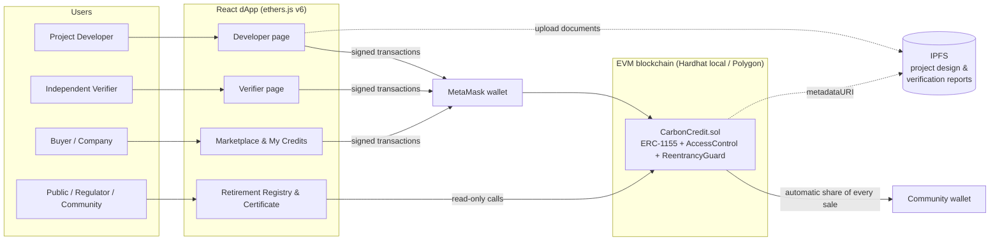
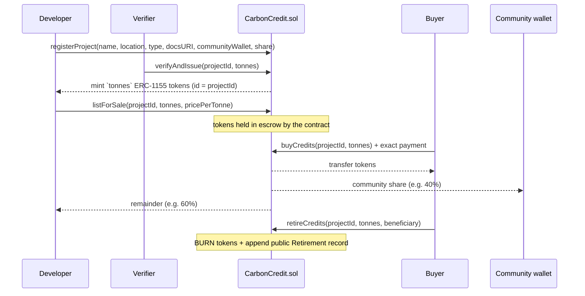
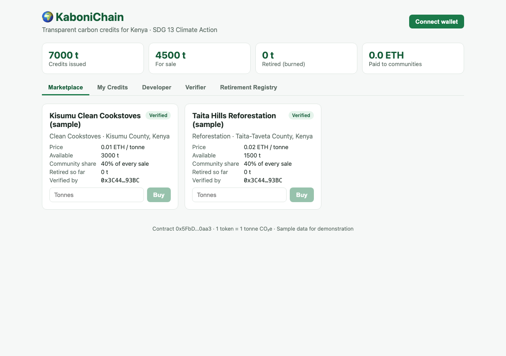
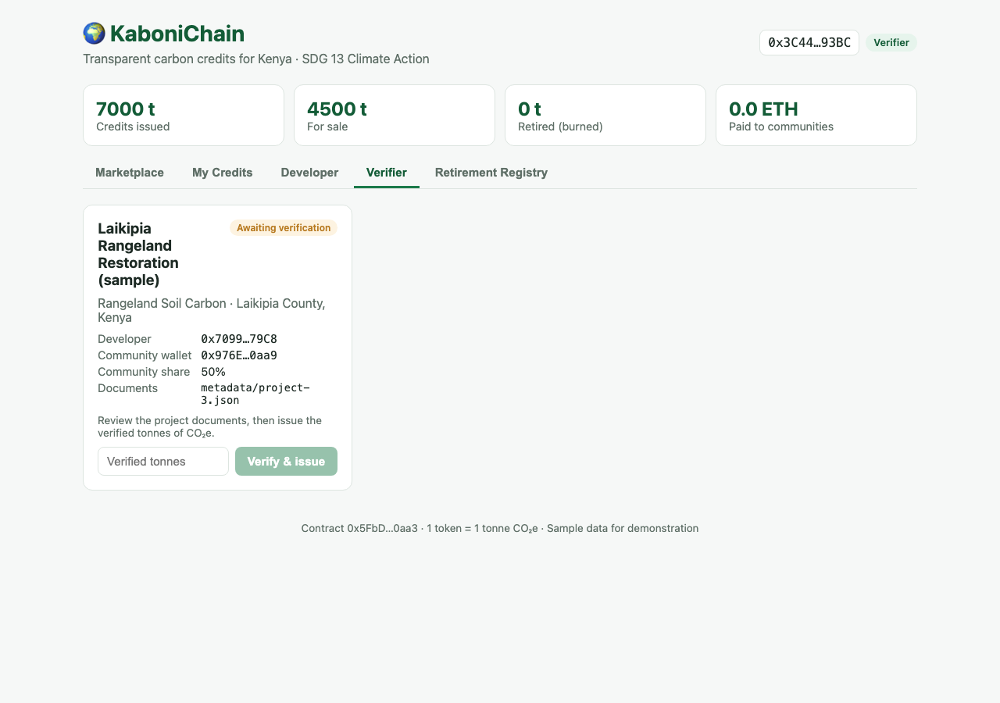
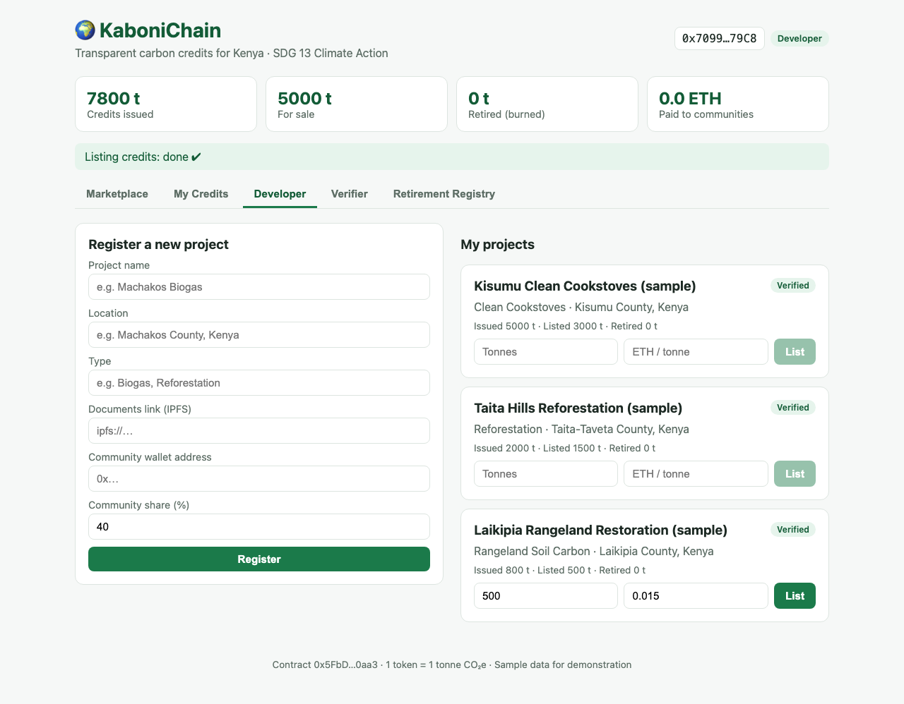
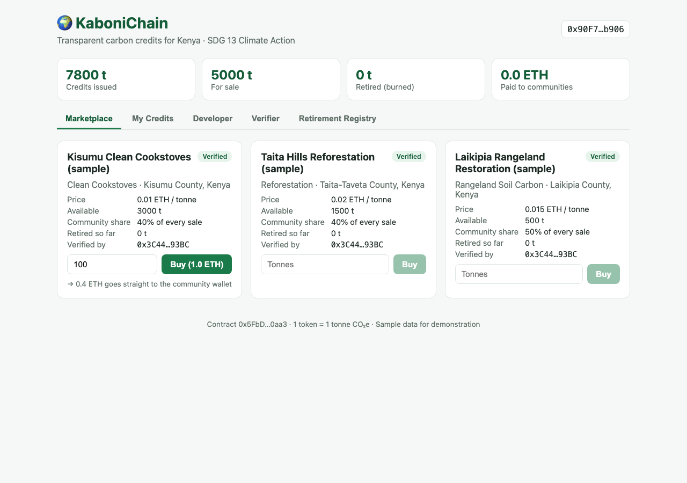
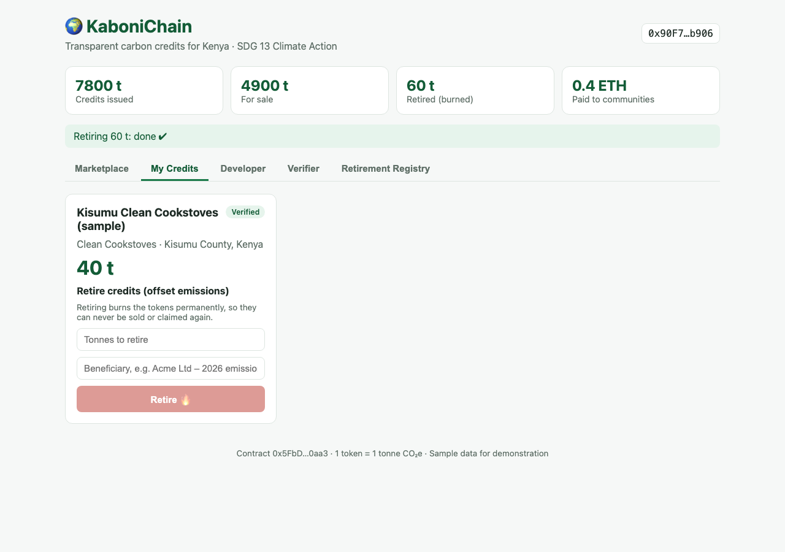
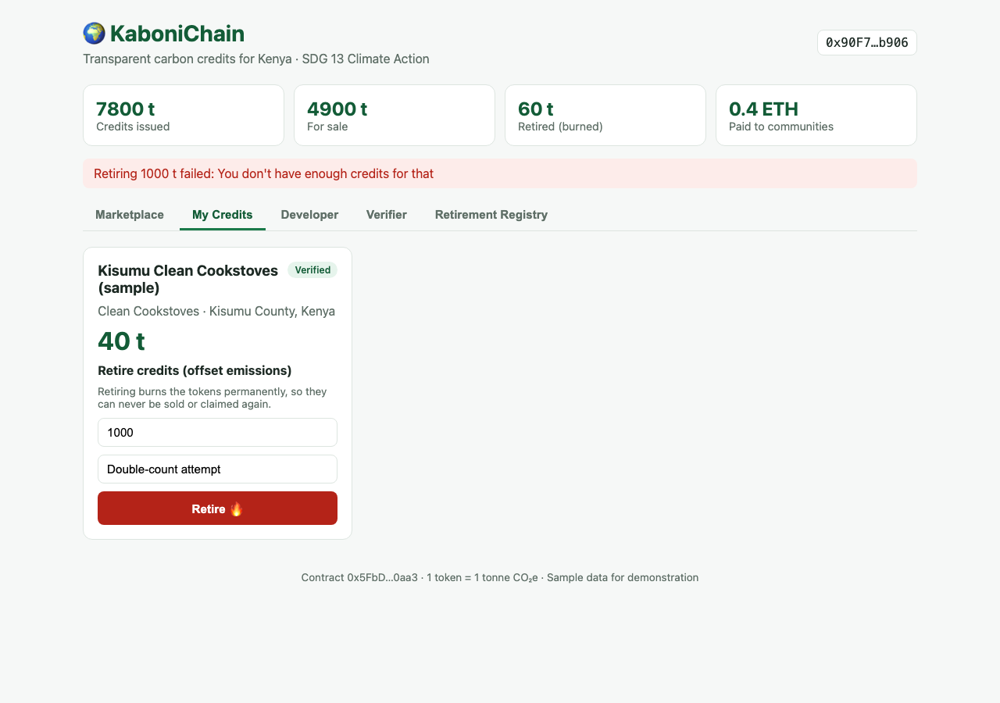
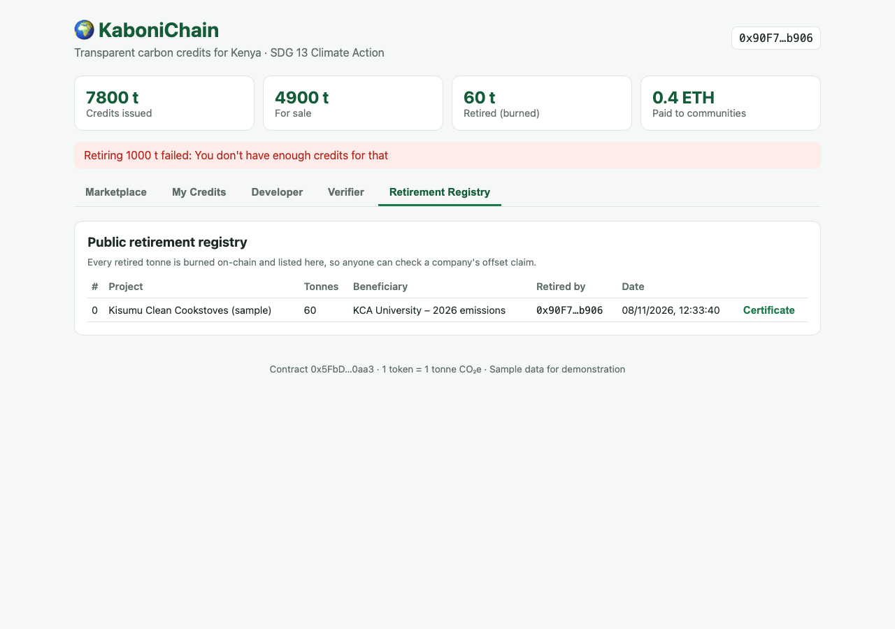
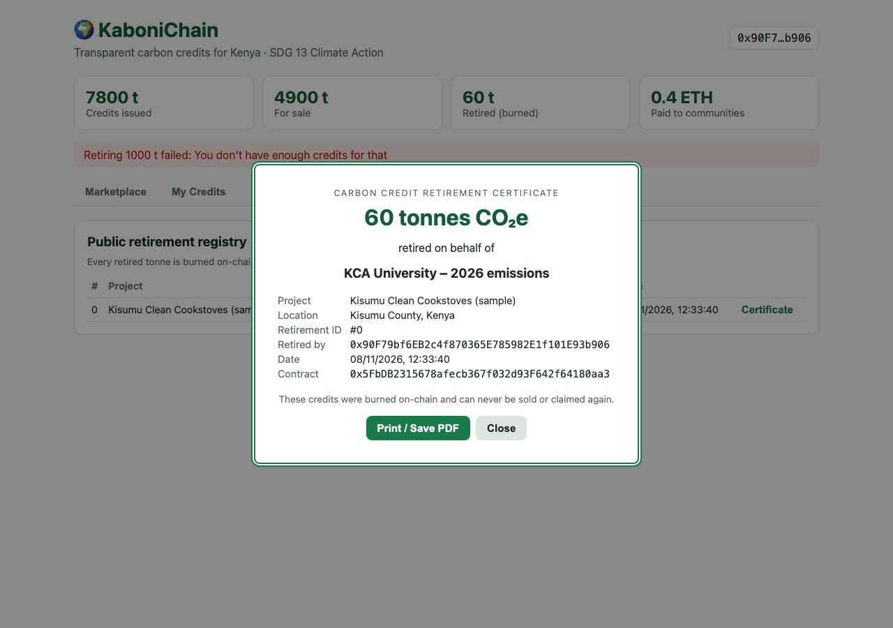

# KaboniChain: Blockchain-Based Carbon Credit Tokenization for Kenya

**SDG 13: Climate Action** · KCA University · Blockchain Technology Project (Framework #10)

**Team members:** _add names_ · **Submission date:** November 2026

**Repository:** https://github.com/H1baq/SDG-13-Climate-Action

---

## Abstract

Carbon markets are meant to direct finance to projects that reduce or remove greenhouse gas emissions. The voluntary carbon market (VCM), however, is losing trust. Peer-reviewed studies and investigative journalism have found widespread over-crediting. The same tonne of CO₂e can be claimed more than once (double-counting). A large share of the value of each credit is captured by intermediaries rather than the communities that host projects. Kenya is Africa's largest generator of carbon credits and has responded with the Climate Change (Amendment) Act, 2023. The Act requires community development agreements guaranteeing communities at least 40% (land-based projects) or 25% (non-land-based projects) of a project's aggregate earnings, and it creates a National Carbon Registry.

This report presents **KaboniChain**, a decentralised application (dApp) that tokenises verified carbon credits as ERC-1155 tokens (1 token = 1 tonne CO₂e) and records each credit's life cycle on a public blockchain. Five rules are enforced in the smart contract:

- only an independent verifier can issue credits;
- a developer cannot verify their own project;
- each project can be issued only once;
- every sale splits the payment automatically between the developer and a community wallet, at or above a platform minimum share;
- retiring a credit burns the token, so it can never be resold or claimed again.

The system was built with Solidity 0.8.24, OpenZeppelin Contracts 5.6, Hardhat, React and ethers.js. All 18 automated tests pass. They include tests showing that a retired credit can be neither re-retired nor transferred, and that payments are split 60/40 in the same transaction as the sale. An end-to-end run through the web interface reproduced the full life cycle: register, verify, list, buy, retire and certify. The report also discusses what blockchain cannot solve, chiefly the quality of the underlying verification, and what is needed to align the prototype with Kenya's national registry.

**Keywords:** carbon credits, blockchain, tokenization, double-counting, benefit-sharing, ERC-1155, Kenya, SDG 13

---

## Table of contents

1. [Introduction](#1-introduction)
2. [Literature review](#2-literature-review)
3. [System design](#3-system-design)
4. [Implementation](#4-implementation)
5. [Testing and results](#5-testing-and-results)
6. [Discussion](#6-discussion)
7. [Conclusion](#7-conclusion)
8. [References](#references)
9. [Appendices](#appendices)

---

## 1. Introduction

### 1.1 Background

Human activities have warmed the planet by about 1.1 °C above pre-industrial levels. Limiting warming to 1.5 °C requires deep, rapid and sustained cuts in greenhouse gas (GHG) emissions this decade (IPCC, 2023). Carbon markets are one of the tools the international community relies on to finance those cuts. A **carbon credit** is a tradable certificate representing one tonne of carbon dioxide equivalent (tCO₂e) that has been reduced, avoided or removed by a project. Credits are issued by a standard (for example Verra or Gold Standard) after an independent auditor verifies the project's claims. A company or individual who buys a credit can **retire** it, which removes it from circulation, and count the tonne against their own emissions.

There are two broad kinds of market. **Compliance markets** are created by law, such as an emissions trading scheme. **Voluntary carbon markets** are where companies, organisations and individuals buy credits for their own climate goals. The Paris Agreement adds a third layer: under Article 6, countries may transfer emission reductions between themselves to meet their Nationally Determined Contributions (NDCs) (UNFCCC, 2015). Each layer depends on the same promise: one credit equals one real tonne, counted once.

Kenya plays a large role in this market. At the launch of the Africa Carbon Markets Initiative at COP27, the President of Kenya stated that the country was "already a leader in the generation of carbon credits in Africa, accounting for over 20% of Africa's volumes over the past 5 years" (Ruto, 2022). Kenyan credits come from clean cookstoves, forest conservation and reforestation, rangeland soil carbon, and renewable energy projects. Kenya has also committed to reduce emissions by 32% below business-as-usual by 2030 (Government of Kenya, 2020), and carbon finance is part of how that target is to be funded.

### 1.2 Problem statement

The VCM is in a crisis of confidence. Reported transaction volume fell by 56% in 2023, and total value fell to US$723 million (Forest Trends' Ecosystem Marketplace, 2024). Three problems lie behind the decline:

1. **Low-quality and over-issued credits.** A joint investigation by *The Guardian*, *Die Zeit* and SourceMaterial reported that more than 90% of the rainforest credits it examined from the largest certifier were likely "phantom credits" (Greenfield, 2023). A peer-reviewed study of 26 forest-conservation projects found that most did not significantly reduce deforestation, and that where they did, the reduction was much smaller than claimed (West et al., 2023). Cookstove projects, which are common in Kenya, were found to be over-credited by roughly a factor of ten (Gill-Wiehl et al., 2024).
2. **Double-counting and lack of traceability.** Credits are recorded in separate, centrally controlled registries. The same reduction can be counted by more than one party, for example by the host country and by the buyer, or sold twice across registries (Schneider et al., 2019). Buyers, regulators and the public cannot easily trace a credit from its origin to its retirement.
3. **Intermediary capture and unfair benefit-sharing.** Kenya's President has said that "80% of the value of some carbon credits are captured by intermediaries, leaving only a fraction for the communities undertaking the actual hard work on the ground" (Ruto, 2022, para. 14). Survival International's *Blood Carbon* report questioned whether communities on the Northern Kenya Rangelands project had given free, prior and informed consent, and whether the project had a legal basis to trade carbon from their land (Counsell, 2023).

Kenya responded with the Climate Change (Amendment) Act, 2023. It requires land-based projects to share at least 40%, and non-land-based projects at least 25%, of the previous year's aggregate earnings with the community, through a community development agreement recorded in a National Carbon Registry (Climate Change Act, Cap. 387A, s. 23E(5)(b), (6)). The law sets the rule, but on its own it gives communities no way to check, in real time, how much a project has earned and whether their share has been paid.

**Problem statement:** *Kenya's carbon credit market lacks a transparent, tamper-proof way to track credits from issuance to retirement. This allows double-counting, hides revenue flows, and leaves communities unable to verify that they receive the share the law guarantees them.*

### 1.3 Objectives

The general objective is to design, build and evaluate a blockchain-based platform that makes Kenyan carbon credits traceable from issuance to retirement and pays communities their share automatically. The specific objectives are:

1. Tokenise verified carbon credits so that **1 token = 1 tonne CO₂e**.
2. **Prevent double-counting** by burning tokens when credits are retired.
3. Provide a **public registry** in which anyone can trace a credit from project to retirement.
4. **Pay communities automatically** at the moment of sale, at or above a minimum share.
5. Restrict issuance to **independent verifiers**, and block self-verification and repeat issuance.
6. Test every rule automatically and demonstrate the complete flow through a web interface.

### 1.4 Scope and limitations

**In scope:** a smart contract implementing the five-step credit life cycle (register, verify and issue, list, buy, retire); role-based access control; automatic benefit-sharing; a React web application with pages for each role; automated tests; and a deployment script with three sample Kenyan projects. The system runs on a local Hardhat Ethereum network and is designed to be deployable to a public EVM network such as Polygon.

**Out of scope:** real measurement, reporting and verification (MRV) of emission reductions; integration with Verra, Gold Standard or Kenya's National Carbon Registry; fiat payments; and legal recognition of tokens. All project data is sample data. The limitations are discussed in full in [Section 6.2](#62-limitations).

### 1.5 Alignment with SDG 13 and Kenyan law

SDG 13 calls on countries to "take urgent action to combat climate change and its impacts" (United Nations, 2015). KaboniChain contributes most directly to **Target 13.2**: "Integrate climate change measures into national policies, strategies and planning." It does this in three ways:

- It turns the benefit-sharing and registry provisions of the Climate Change Act (ss. 23E–23G) into software rules that run automatically, rather than relying on paper agreements.
- It protects the **integrity** of the credits that Kenya counts towards its climate finance and NDC, because a burned credit cannot be counted twice. The Act itself requires emission reductions to be "carefully recorded and documented for every offset scheme, utilizing appropriate accounting terms, corresponding adjustments, and location of offset" (Climate Change Act, Cap. 387A, s. 23B(d)).
- It makes climate-finance flows to communities **publicly verifiable**, which supports Target 13.a (mobilising climate finance) and the "leave no one behind" principle of the 2030 Agenda.

---

## 2. Literature review

### 2.1 How voluntary carbon markets work

A credit passes through a predictable life cycle:

1. A **project developer** designs a project and documents it using an approved methodology.
2. A **validation and verification body** audits the claimed reductions.
3. A **standard or registry** issues credits into the developer's registry account.
4. Credits are sold, directly or through **brokers and exchanges**.
5. A **buyer retires** them to make a claim.

Each step involves a different organisation, and the record of each step usually lives in a different system. In 2023 the market traded about 111 MtCO₂e at an average price of US$6.53 per tonne (Forest Trends' Ecosystem Marketplace, 2024).

To restore trust, the Integrity Council for the Voluntary Carbon Market (ICVCM) published its Core Carbon Principles and assessment framework in 2023. These set threshold standards for issues such as additionality, permanence, robust quantification and "no double counting" (Integrity Council for the Voluntary Carbon Market [ICVCM], 2023). Kenya's Climate Change (Carbon Markets) Regulations, 2024 add national rules for projects operating in the country, including registration with the National Carbon Registry (Climate Change (Carbon Markets) Regulations, 2024).

### 2.2 Problems in the market

**Double-counting.** Schneider et al. (2019) define double-counting as counting the same emission reduction more than once towards climate goals. It can happen in three ways:

- **double issuance:** two credits are issued for one reduction;
- **double use:** one credit is retired or claimed twice;
- **double claiming:** a host country and a buyer both count the same reduction.

They argue that resolving double-counting is "critical for achieving the goals of the Paris Agreement." Kenya's law addresses double claiming through **corresponding adjustments**, defined as the host deducting reductions that the receiving party adds (Climate Change Act, Cap. 387A, s. 2). Double use and double issuance are record-keeping failures, and these are the failures a shared ledger is suited to prevent.

**Over-crediting and quality.** West et al. (2023) used synthetic control methods on 26 REDD+ project sites in six countries and found that most projects did not significantly reduce deforestation; the projects' ex-ante baselines overstated the counterfactual. Gill-Wiehl et al. (2024) examined five cookstove methodologies and estimated that projects were over-credited by about 9–10 times, mainly because of exaggerated stove-use estimates and assumptions about fuelwood. These findings matter for Kenya, where cookstoves and land-based projects are major credit sources. They also set an important boundary for this project: **a blockchain can guarantee that a record is not altered after it is written, but not that the record was true when written.**

**Intermediary fees and benefit-sharing.** When credits pass through several brokers, the price paid by the final buyer can be far higher than the amount received by the project and the community. Kenya's President has said that intermediaries capture up to 80% of the value of some credits (Ruto, 2022). Counsell (2023) documents community concerns on one of the world's largest soil-carbon projects in northern Kenya. These include weak consent processes and questions about who owns the carbon. Kenya's 2023 amendment responds with mandatory community development agreements and minimum shares (Climate Change Act, Cap. 387A, s. 23E).

### 2.3 Blockchain fundamentals

A **blockchain** is an append-only ledger replicated across many computers. New records are grouped into blocks, each linked to the previous one by a cryptographic hash. Changing an old record would change every later hash, so the history is tamper-evident. Nakamoto (2008) introduced the design to solve the **double-spending** problem in digital cash without a trusted third party. Double-counting a carbon credit is the same problem in a different domain.

**Smart contracts**, a concept described by Szabo (1997), are programs whose rules execute automatically. Ethereum (Buterin, 2014) made them general-purpose. A contract holds state and enforces rules on every transaction, and no single party can override it. For a carbon market this means:

- issuance limits, payment splits and burning are enforced by code rather than by trusting an operator;
- every state change emits a public event that anyone can audit.

**Tokens** are records of ownership kept by a contract. ERC-20 defines interchangeable (fungible) tokens, and ERC-721 defines unique (non-fungible) ones. **ERC-1155** (Radomski et al., 2018) is a multi-token standard in which one contract manages many token types, each identified by an ID with its own supply and metadata. This fits carbon credits well:

- credits from the same project and batch are interchangeable;
- credits from different projects are not, because a cookstove tonne is not the same product as a forest tonne.

Energy use was an early objection to blockchains. Since Ethereum moved from proof-of-work to proof-of-stake in "The Merge", its annual electricity consumption has fallen by more than 99.98% (Ethereum Foundation, n.d.). This makes public EVM chains defensible for climate applications.

Large documents are expensive to store on-chain, so dApps typically store them on the **InterPlanetary File System (IPFS)**. IPFS addresses each file by the hash of its content (Benet, 2014). Storing an IPFS link in a contract therefore makes the linked document tamper-evident: if the document changes, its address changes too.

### 2.4 Blockchain in carbon markets

**Tlili (2025)** gives empirical evidence on tokenised carbon markets. Using a panel of daily transactions from leading tokenised carbon platforms between 2020 and 2023 and a fixed-effects difference-in-differences design, the study finds that blockchain adoption improves pricing efficiency under certain liquidity conditions, with limited short-term effects on trading volume. The study also finds that higher transaction costs may act as a signal of trusted infrastructure in illiquid sustainability markets, and it argues that blockchain can reduce transactional inefficiencies in carbon markets. For this project, Tlili's evidence supports the case that on-chain infrastructure improves how the market functions. The finding on transaction costs is also a caution: lower fees alone do not create trust, and the credibility of the infrastructure matters.

**Golshani and Mankar (2025)** propose a "democratized" carbon credit trading platform on a blockchain. They argue that the main drawback of existing platforms is that a central body controls verification, distribution and price setting. Their architecture defines roles for producers, regulators and market participants, and follows the life cycle of a credit from issuance through trading to burning. KaboniChain adopts the same principles of role separation and a burn-on-retirement life cycle, and narrows them to a specific gap: **benefit-sharing with host communities under Kenyan law**, which a general trading architecture does not address.

**Industry experience.** The first large-scale experiment in on-chain carbon was the "bridging" of existing registry credits onto public blockchains by protocols such as Toucan, which fed DeFi markets such as KlimaDAO. In May 2022, Verra stopped allowing retired credits to be turned into tokens, because the registry showed the credit as consumed while a token representing it continued to trade. By September 2022 it was reviewing retirement requests for any link to tokenisation (DLA Piper, 2022). This episode shows that **two ledgers recording the same asset without coordination create a new double-counting risk**. In KaboniChain, the token *is* the credit: it is minted by the verifier and burned on retirement, so there is a single source of truth.

Bassi et al. (2025) mapped organisations in the blockchain-based voluntary carbon market for nature-based credits. They found that no single blockchain dominates (Polygon, Ethereum and Celo are the most frequently used) and that partnerships are driven more by shared partners than by shared technology. Citing Sipthorpe et al. (2022), they note that most blockchain initiatives for carbon markets were still at proof-of-concept level. This places KaboniChain where most of the field is: a proof of concept that should be judged on whether its design closes real gaps.

### 2.5 Insights from the video references

Nadcab Labs (2025) explains carbon credit tokenisation for a general audience. It presents on-chain tracking, as on Toucan and Polygon, as a way to show where a credit came from and when it was retired, and to reduce double-counting and greenwashing. It also stresses that independent verification by standards bodies and monitoring data is still needed to prevent fraud. The second video reference, *How Carbon Credit Trading Works: The $1.5T Market*, explains the mechanics of buying, selling and retiring credits, and the difference between compliance and voluntary markets. The two together informed the design choices in Chapter 3: tokens track ownership and retirement, while the quality of the underlying credit still depends on off-chain verification.

### 2.6 Research gap

| Existing work | What it covers | What it leaves open |
|---|---|---|
| Registry-based markets (Verra, Gold Standard) | Issuance, retirement records | Records are centralised; communities cannot see revenue; double counting across registries remains possible (Schneider et al., 2019) |
| Bridged tokens (Toucan, KlimaDAO) | Liquidity and price discovery on-chain | Two ledgers for one asset; conflict with registry retirement (DLA Piper, 2022) |
| Tlili (2025) | Market efficiency of tokenised carbon | Does not address benefit-sharing or community verification |
| Golshani & Mankar (2025) | Decentralised trading architecture and life cycle | General design; not tied to a national benefit-sharing law |
| Kenya's 2023 law | Minimum community shares, CDAs, national registry | No mechanism for real-time verification by communities |

**Gap addressed by this project:** a single-ledger design, in which the token *is* the credit and is burned on retirement, that also **enforces community benefit-sharing at the moment of sale** and makes every payment publicly checkable, in the context of Kenya's Climate Change (Amendment) Act, 2023.

---

## 3. System design

### 3.1 Why blockchain and not a database?

A blockchain is justified when several parties who do not fully trust each other need to share and update the same records, and no single party should control them. The carbon market has these properties:

- **Developers** want to sell as many credits as possible.
- **Verifiers** are paid by developers.
- **Buyers** want credible claims.
- **Communities** want their share.
- **Government** wants accurate national accounting.

| Question | Traditional database | KaboniChain |
|---|---|---|
| Who controls the records? | One organisation, which can edit or delete history | No single party; history is append-only |
| Can a buyer independently check a credit? | Only if the operator allows it | Yes; anyone can read the chain |
| Can the same credit be sold or retired twice? | Prevented only if the operator is honest and systems are connected | Prevented by the protocol: a burned token no longer exists |
| Are community payments guaranteed? | Depends on the developer paying later | Paid in the same transaction as the sale |
| What if the operator shuts down? | Records may be lost | Records persist on the network |

Double-counting a credit is the carbon-market equivalent of double-spending, the problem blockchains were designed to solve (Nakamoto, 2008).

### 3.2 Pain point to feature mapping

| Pain point | Feature | Where in code |
|---|---|---|
| Double-counting (double use) | Retiring burns the token; a burned token cannot be transferred, sold or retired again | `retireCredits()` → `_burn()` |
| Double issuance / over-issuance | Each project can be issued only once | `AlreadyVerified` check in `verifyAndIssue()` |
| Self-certified credits | Only `VERIFIER_ROLE` can issue; a developer cannot verify their own project | `onlyRole(VERIFIER_ROLE)`, `SelfVerification` |
| Lack of transparency | Every project, issuance, sale and retirement is public state plus an event; documents are linked by content hash | `getAllProjects()`, `getAllRetirements()`, events, `metadataURI` |
| Intermediary capture | Buyers pay the contract directly; no broker sits in the payment path | `buyCredits()` |
| Communities shortchanged | Payment split in the same transaction, with a platform-wide minimum share | `communityShareBps`, `minCommunityShareBps`, `_pay()` |

### 3.3 Architecture



*Figure 1. System architecture.*

The frontend reads all data directly from the chain through a read-only RPC provider, so anyone can view projects, sales totals and retirements without a wallet. Actions that change state are signed by the user's wallet (MetaMask) and sent to the contract.

### 3.4 Credit life cycle



*Figure 2. Credit life cycle.*

### 3.5 Smart contract design

**Roles.** The contract uses OpenZeppelin `AccessControl` with three roles:

| Role | Holder | Can |
|---|---|---|
| `DEFAULT_ADMIN_ROLE` | Deployer (in production: a multi-signature wallet or regulator) | Grant and revoke roles; set the minimum community share |
| `DEVELOPER_ROLE` | Project developers | Register projects; list their own verified credits |
| `VERIFIER_ROLE` | Accredited verification bodies | Verify a project and issue its credits |

Buying and retiring are open to any account, because anyone may offset emissions.

**Data structures.**

```solidity
struct Project {
    uint256 id;
    string name; string location; string projectType;
    string metadataURI;          // IPFS link to design document + verification report
    address developer;
    address communityWallet;
    uint16 communityShareBps;    // basis points: 4000 = 40%
    bool verified; address verifier;
    uint256 totalIssued; uint256 totalRetired;
    uint256 listedAmount;        // credits currently in escrow
    uint256 pricePerTonne;       // in wei
}

struct Retirement {
    uint256 projectId; address retiredBy; uint256 amount;
    string beneficiary;          // who the offset is claimed for
    uint256 timestamp;
}
```

Shares are stored in **basis points** (1/100 of a percent), so the contract uses only integer arithmetic. Solidity has no floating-point numbers, and integer basis points avoid rounding ambiguity.

**Functions.**

| Function | Who | Effect |
|---|---|---|
| `registerProject(...)` | Developer | Creates a project; requires a non-zero community wallet and a share ≥ the platform minimum |
| `verifyAndIssue(id, tonnes)` | Verifier | Marks the project verified and mints `tonnes` tokens to the developer; reverts if already verified or if the verifier is the developer |
| `listForSale(id, tonnes, price)` | The project's developer | Moves tokens into contract escrow and sets the price |
| `buyCredits(id, tonnes)` | Anyone | Requires exact payment; transfers tokens to the buyer; pays the community share and the developer remainder |
| `retireCredits(id, tonnes, beneficiary)` | Any holder | Burns the tokens and appends a public `Retirement` record |
| `getAllProjects()`, `getAllRetirements()`, `getProject()`, `getRetirement()` | Anyone | Public read access |
| `setMinCommunityShareBps(bps)` | Admin | Updates the platform minimum share |

**Events.** `ProjectRegistered`, `CreditsIssued`, `CreditsListed`, `CreditsSold` (including `developerPaid` and `communityPaid`) and `CreditsRetired`. These events form a permanent audit trail. The frontend sums `communityPaid` across all `CreditsSold` events to show the total paid to communities.

**Custom errors.** `ProjectNotFound`, `NotProjectDeveloper`, `AlreadyVerified`, `NotVerified`, `InvalidAmount`, `InvalidAddress`, `ShareOutOfRange`, `NotEnoughListed`, `WrongPayment`, `SelfVerification` and `TransferFailed`. Custom errors cost less gas than revert strings, and the frontend translates them into plain-language messages.

**Why ERC-1155.** Each project receives its own token ID inside one contract. Credits within a project are fungible, while credits across projects are distinguishable. This is cheaper and simpler than deploying one ERC-20 per project, and it follows the ERC-1155 metadata convention: `uri(id)` returns the project's IPFS document link (Radomski et al., 2018).

### 3.6 On-chain and off-chain data

| On-chain (contract state and events) | Off-chain (IPFS, linked by content hash) |
|---|---|
| Project ID, name, location, type | Project design document (PDF) |
| Developer, verifier and community wallet addresses | Verification / audit report |
| Issued, listed and retired totals; price | Photos, maps, monitoring data |
| Every sale (with the split paid) and every retirement | Community development agreement |

Large files are kept off-chain because on-chain storage is expensive. Each IPFS address is derived from its file's content (Benet, 2014), so a tampered document no longer matches the address stored on-chain. Sample metadata files are in [`metadata/`](../metadata).

### 3.7 Tools and justification

| Tool | Version | Why it was chosen |
|---|---|---|
| Solidity | 0.8.24 | Most widely used smart-contract language; built-in overflow checks since 0.8 |
| OpenZeppelin Contracts | 5.6.1 | Audited, standard implementations of ERC-1155, AccessControl and ReentrancyGuard, which avoids re-implementing security-critical code |
| Hardhat (+ Toolbox, Mocha/Chai) | 2.29.1 | Local Ethereum network, compilation, scripted deployment and automated testing |
| React + Vite | 18.3.1 / 5.4.10 | Component-based UI with a fast development server |
| ethers.js | 6.13.4 | Library for reading contracts and sending wallet-signed transactions |
| MetaMask | n/a | Most common browser wallet; users keep their own keys |
| IPFS | n/a | Content-addressed document storage linked from the contract |

---

## 4. Implementation

### 4.1 Development environment and setup

The project has three parts:

- [`contracts/CarbonCredit.sol`](../contracts/CarbonCredit.sol): the smart contract, 278 lines;
- [`scripts/deploy.js`](../scripts/deploy.js): deploys the contract, assigns roles, seeds sample projects, and writes the contract address and ABI into the frontend;
- [`frontend/`](../frontend): the React dApp.

The Hardhat configuration compiles with Solidity 0.8.24 (optimizer enabled, 200 runs, `cancun` EVM target). It uses the npm `solc` package instead of downloading the compiler, so the project builds on networks that block the compiler download site. Full setup instructions are in [Appendix A](#appendix-a-setup-guide).

### 4.2 Smart contract implementation

The three functions that carry the project's main guarantees are shown below. They are excerpts from [`CarbonCredit.sol`](../contracts/CarbonCredit.sol).

**Issuance by an independent verifier, once only.**

```solidity
function verifyAndIssue(uint256 projectId, uint256 tonnes) external onlyRole(VERIFIER_ROLE) {
    Project storage p = _getProject(projectId);
    if (p.verified) revert AlreadyVerified();              // no double issuance
    if (tonnes == 0) revert InvalidAmount();
    if (p.developer == msg.sender) revert SelfVerification(); // no self-certification

    p.verified = true;
    p.verifier = msg.sender;
    p.totalIssued = tonnes;

    _mint(p.developer, projectId, tonnes, "");
    emit CreditsIssued(projectId, msg.sender, tonnes);
}
```

**Sale with automatic benefit-sharing.** The buyer must send the exact price. The community's share is calculated in basis points and paid in the same transaction, and the developer receives the remainder, so no rounding loss goes unpaid. State is updated *before* any external call (the checks-effects-interactions pattern), and the function is protected by `nonReentrant`.

```solidity
function buyCredits(uint256 projectId, uint256 tonnes) external payable nonReentrant {
    Project storage p = _getProject(projectId);
    if (tonnes == 0) revert InvalidAmount();
    if (tonnes > p.listedAmount) revert NotEnoughListed();
    uint256 cost = tonnes * p.pricePerTonne;
    if (msg.value != cost) revert WrongPayment();

    p.listedAmount -= tonnes;                                  // effects first

    uint256 communityPaid = (cost * p.communityShareBps) / MAX_BPS;
    uint256 developerPaid = cost - communityPaid;

    _safeTransferFrom(address(this), msg.sender, projectId, tonnes, "");
    _pay(p.communityWallet, communityPaid);                    // interactions last
    _pay(p.developer, developerPaid);

    emit CreditsSold(projectId, msg.sender, tonnes, developerPaid, communityPaid);
}
```

**Retirement by burning.** `_burn` reverts if the caller holds fewer tokens than requested. Once burned, the tokens no longer exist, so they cannot be retired again, transferred or resold.

```solidity
function retireCredits(uint256 projectId, uint256 tonnes, string calldata beneficiary)
    external returns (uint256 retirementId)
{
    Project storage p = _getProject(projectId);
    if (tonnes == 0) revert InvalidAmount();

    _burn(msg.sender, projectId, tonnes);   // reverts if caller doesn't hold enough
    p.totalRetired += tonnes;

    retirementId = _retirements.length;
    _retirements.push(Retirement(projectId, msg.sender, tonnes, beneficiary, block.timestamp));
    emit CreditsRetired(retirementId, projectId, msg.sender, tonnes, beneficiary);
}
```

Credits listed for sale are held by the contract itself, which inherits OpenZeppelin's `ERC1155Holder` so that it can receive ERC-1155 tokens. While listed, the developer cannot move or double-sell them.

### 4.3 Frontend implementation

The dApp ([`frontend/src/App.jsx`](../frontend/src/App.jsx)) uses two connections to the chain:

- **Reading** uses a `JsonRpcProvider` connected directly to the node, so the dashboard, marketplace and registry work for any visitor without a wallet. This is the transparency requirement.
- **Writing** uses the user's MetaMask wallet through ethers' `BrowserProvider`. On connection, the app switches MetaMask to the correct chain (or offers to add it) and checks which roles the account holds, so it can show the right pages.

Contract errors are translated into plain-language messages. For example, `ERC1155InsufficientBalance` becomes "You don't have enough credits for that." The dashboard shows four live totals: credits issued, credits for sale, credits retired, and ETH paid to communities.

The figures below come from an end-to-end run of the dApp. Starting from the seeded data, a verifier issued 800 t for the Laikipia project. The developer then listed 500 t at 0.015 ETH per tonne. A buyer bought 100 t of Kisumu cookstove credits, retired 60 t for "KCA University – 2026 emissions", and then tried to retire 1,000 t.


*Figure 3. Marketplace (no wallet connected). Live totals at the top; each verified project shows price, available tonnes, community share, tonnes retired and the verifier's address.*


*Figure 4. Verifier page. Projects awaiting verification show their developer, community wallet, share and documents link. Only a `VERIFIER_ROLE` account sees the issue form.*


*Figure 5. Developer page. The registration form (left) and the developer's projects with issued, listed and retired totals (right). The Laikipia project has just been verified (800 t) and is being listed.*


*Figure 6. Buying 100 t of Kisumu cookstove credits for 1.0 ETH. The interface shows, before the buyer confirms, that 0.4 ETH (40%) will go straight to the community wallet.*


*Figure 7. My Credits after retiring 60 t. The buyer's balance has fallen from 100 t to 40 t, and "Retired (burned)" at the top shows 60 t.*


*Figure 8. Attempting to retire 1,000 t while holding 40 t is rejected by the contract: "You don't have enough credits for that."*


*Figure 9. Public retirement registry. Every retirement is listed with project, tonnes, beneficiary, the retiring account and the time.*


*Figure 10. Retirement certificate generated from on-chain data, including the retirement ID, the retiring account and the contract address, so that any third party can verify the claim. It can be printed or saved as PDF.*

### 4.4 Deployment

[`scripts/deploy.js`](../scripts/deploy.js) runs these steps:

1. Deploys `CarbonCredit` with a **platform minimum community share of 25% (2,500 bps)**, matching the legal floor for non-land-based projects.
2. Grants the developer and verifier roles to Hardhat accounts #1 and #2.
3. Seeds three sample Kenyan projects with community wallets #4–#6:

| # | Project | Type | Community share | Seeded state |
|---|---|---|---|---|
| 1 | Kisumu Clean Cookstoves | Clean cookstoves (non-land-based) | 40% | Verified, 5,000 t issued, 3,000 t listed at 0.01 ETH/t |
| 2 | Taita Hills Reforestation | Reforestation (land-based) | 40% | Verified, 2,000 t issued, 1,500 t listed at 0.02 ETH/t |
| 3 | Laikipia Rangeland Restoration | Rangeland soil carbon (land-based) | 50% | Registered, awaiting verification |

4. Writes the contract address, chain ID and ABI to `frontend/src/contract.json`, which the dApp imports.

The local network is Hardhat (chain ID 31337). The configuration includes a commented-out entry for the Polygon Amoy testnet. Moving to it requires only an RPC URL and a funded deployer key in an uncommitted `.env` file.

---

## 5. Testing and results

### 5.1 Test strategy

The contract is tested with Hardhat, Mocha and Chai ([`test/CarbonCredit.test.js`](../test/CarbonCredit.test.js), 18 tests). Each test starts from a fresh deployment using a fixture, so tests are independent. Two kinds of test are included:

- **positive tests:** the intended action succeeds and has the right effects, including emitted events and balances;
- **negative tests:** every forbidden action reverts with the expected custom error.

A final **invariant test** checks the accounting identity *issued = held + listed + retired* after every step of a full life cycle.

### 5.2 Test cases

| # | Group | Test | Rule demonstrated |
|---|---|---|---|
| 1 | Register | Developer can register a project | Happy path |
| 2 | Register | Accounts without `DEVELOPER_ROLE` are blocked | Access control |
| 3 | Register | Community share below platform minimum is rejected | Benefit-sharing floor |
| 4 | Verify & issue | Verifier approval mints credits to the developer | Issuance |
| 5 | Verify & issue | Non-verifiers cannot issue | Access control |
| 6 | Verify & issue | A developer cannot verify their own project | No self-certification |
| 7 | Verify & issue | A project cannot be issued twice | No double issuance |
| 8 | List | Listing moves credits into escrow | Escrow |
| 9 | List | An unverified project cannot be listed | Only verified credits trade |
| 10 | List | Only the project developer can list | Ownership |
| 11 | Buy | Credits transfer and payment splits 60/40 between developer and community | **Automatic benefit-sharing** |
| 12 | Buy | Wrong payment amount is rejected | Exact pricing |
| 13 | Buy | Cannot buy more than is listed | No overselling |
| 14 | Retire | Retiring burns credits and records the retirement publicly | Burn + registry |
| 15 | Retire | A retired credit cannot be retired again | **No double use** |
| 16 | Retire | A retired credit cannot be resold or transferred | **No double use** |
| 17 | Retire | Cannot retire credits you don't own | Ownership |
| 18 | Life cycle | issued = held + listed + retired at every step | Conservation of credits |

**Result: 18 of 18 passed** (Node.js 26.13.0; full output in [Appendix B](#appendix-b-full-test-output)).

### 5.3 End-to-end demonstration results

The scenario in [Section 4.3](#43-frontend-implementation) was carried out through the web interface on a fresh local chain. Every transaction was signed by the relevant role's account.

| Step | Account | Action | Observed result |
|---|---|---|---|
| 1 | Verifier | Verify & issue 800 t (Laikipia) | "Verifying & issuing: done ✔"; credits issued rose from 7,000 t to 7,800 t |
| 2 | Developer | List 500 t at 0.015 ETH/t | Laikipia appears in Marketplace with 500 t available and a 50% community share |
| 3 | Buyer | Buy 100 t Kisumu for 1.0 ETH | "Paid to communities" rose from 0.0 to **0.4 ETH** (40%) in the same transaction |
| 4 | Buyer | Retire 60 t for "KCA University – 2026 emissions" | Balance 100 t → 40 t; "Retired (burned)" = 60 t; entry #0 in registry |
| 5 | Buyer | Attempt to retire 1,000 t | **Rejected**: "You don't have enough credits for that"; no state change |
| 6 | Public | Open certificate | Certificate shows 60 t, beneficiary, retirement ID, retiring account and contract address |

### 5.4 Gas cost

Gas measures the computational cost of each transaction. The table shows gas used on the Hardhat network for a typical call to each function, measured with the deployed bytecode (optimizer on, 200 runs).

| Operation | Gas used |
|---|---:|
| Deploy contract | 2,845,168 |
| Grant a role | 51,536 |
| `registerProject` | 301,694 |
| `verifyAndIssue` | 108,237 |
| `listForSale` | 107,634 |
| `buyCredits` (incl. two payments) | 90,981 |
| `retireCredits` | 192,636 |

The fee for a transaction is *gas used × gas price*. `registerProject` and `retireCredits` cost the most, because they store strings (project details and the beneficiary name) permanently on-chain. On a low-fee proof-of-stake network such as Polygon, all of these operations are practical for credits sold in batches of tonnes. Gas use could be reduced further by storing long text only in IPFS and keeping only its hash on-chain.

### 5.5 Security considerations

| Threat | Mitigation in KaboniChain |
|---|---|
| Unauthorised issuance or registration | OpenZeppelin `AccessControl`; `onlyRole` modifiers; tested (tests 2, 5) |
| Verifier collusion with developer (same account) | `SelfVerification` check; tested (test 6) |
| Inflating a project's supply after verification | Issuance once per project (`AlreadyVerified`); tested (test 7) |
| Reentrancy during payment | `nonReentrant` on `buyCredits`; state updated before external calls. Reentrancy was the flaw behind several major Ethereum exploits (Atzei et al., 2017) |
| Integer overflow and rounding | Solidity 0.8 checked arithmetic; basis-point integer maths; developer receives `cost − communityPaid`, so no wei is lost |
| Overpaying or underpaying | Exact-payment check (`WrongPayment`); tested (test 12) |
| Selling more than is listed | `NotEnoughListed`; tested (test 13) |
| Double use of a credit | Burn on retirement; tested (tests 15, 16) |
| Silent payment failure | `_pay` reverts the whole sale with `TransferFailed` if a payment fails, so a sale never completes without the community being paid |

The last mitigation has a trade-off: if a community wallet were a contract that refused payments, every sale of that project would revert. A production system should use the **pull-payment** pattern, in which payments are recorded and recipients withdraw them, so that one recipient cannot block sales. This is listed as future work.

---

## 6. Discussion

### 6.1 How the solution addresses each pain point

**Double-counting.** KaboniChain prevents *double use* by design. Retirement destroys the token, and tests 15 and 16 and demonstration step 5 show that a retired tonne cannot be retired again or resold. It prevents *double issuance* within the platform because each project can be issued only once. Because the token is the credit itself, rather than a wrapper around a credit in another registry, it avoids the two-ledger problem that led Verra to stop tokenisation of retired credits (DLA Piper, 2022). It does not by itself prevent *double claiming* between countries. That requires corresponding adjustments, which Kenya's National Carbon Registry is required to record (Climate Change Act, Cap. 387A, s. 23G(3)(h)). Section 6.3 proposes an integration.

**Transparency.** Every project, issuance, sale (with the exact community and developer amounts) and retirement is public. The Marketplace and Registry pages read directly from the chain, so a community member, journalist or regulator can verify the figures without asking the operator.

**Intermediary capture.** Buyers pay the contract, and the contract pays the community and the developer directly. No broker sits in the payment path. This addresses the concern raised by Ruto (2022) for primary sales. It does not stop credits from being resold at a mark-up on secondary markets, but even then the original sale price and the community's share remain public.

**Benefit-sharing.** The community share is fixed at registration, cannot be set below the platform minimum, and is paid in the same transaction as each sale. Demonstration step 3 showed 0.4 ETH of a 1.0 ETH purchase reaching the community wallet immediately. This is stronger than the legal requirement in one respect, because payment happens at each sale rather than once a year. It is weaker in others, as discussed in Section 6.2.

**Verification.** The role system turns the separation between developer and verifier into code. However, a blockchain cannot tell whether a verifier approved a project honestly. This is the "garbage in, garbage out" limit, and it matters given the over-crediting evidence reviewed in Section 2.2 (West et al., 2023; Gill-Wiehl et al., 2024).

### 6.2 Limitations

1. **The oracle problem.** The contract guarantees that records are not altered after they are written, but not that they were true when written. Credit quality still depends on methodologies and auditors. This is also what Nadcab Labs (2025) stresses.
2. **Legal minimum by project type is not enforced.** The Act sets **40%** for land-based and **25%** for non-land-based projects (Climate Change Act, Cap. 387A, s. 23E(5)(b)). The contract enforces one platform-wide minimum (deployed at 25%). The sample land-based projects comply (40% and 50%), but the contract would accept a land-based project at 25%.
3. **Basis of calculation differs from the law.** The law calculates the share on the *previous year's aggregate earnings*, defined as "the total of all income in a carbon project" (s. 2). KaboniChain splits *each on-platform sale*. Income earned outside the platform is not covered.
4. **Secondary transfers are not shared.** ERC-1155 tokens can be transferred directly between holders. A buyer can resell credits privately, and those resales do not trigger a community payment.
5. **One issuance per project.** Real projects issue credits periodically, in **vintages**. The current design allows only one issuance per project.
6. **Listing cannot be cancelled,** and a new listing changes the price for all credits already in escrow.
7. **Admin trust.** The admin grants roles. In production this should be a multi-signature wallet controlled by several institutions, or the Designated National Authority.
8. **Prototype scale and privacy.** The system was tested on a local network with sample data. Payments are in ETH rather than Kenyan shillings, and all transactions, including community wallet balances, are public.
9. **Legal status.** Tokens do not replace Kenya's National Carbon Registry or a standard's registry. Without integration, the platform cannot by itself make a credit legally recognised.

### 6.3 Future work

1. **Type-aware legal minimums:** store whether a project is land-based and enforce 40% or 25% accordingly, in line with s. 23E.
2. **Vintages:** issue a new token ID per project per verification period, so that credits from different years can be told apart.
3. **Pull payments and stablecoins:** record payments for withdrawal (removing the blocking risk in Section 5.5), and settle in a stablecoin, or through mobile-money on- and off-ramps such as M-PESA, so that communities receive Kenyan shillings.
4. **Royalty on secondary sales:** route transfers through the marketplace, or add a transfer hook, so that resales also pay the community.
5. **Registry integration:** anchor community development agreements and retirements in Kenya's National Carbon Registry (ss. 23E(6), 23G), and record corresponding adjustments to prevent double claiming between countries.
6. **Stronger MRV:** feed satellite imagery and IoT data, such as cookstove usage sensors, into verification through oracles. This addresses the over-crediting causes identified by Gill-Wiehl et al. (2024) and West et al. (2023).
7. **Governance:** a multi-signature admin and a verifier accreditation process, with role changes logged on-chain.
8. **Public testnet deployment:** deploy to Polygon Amoy and upload real project documents to IPFS (for example via a pinning service).

---

## 7. Conclusion

KaboniChain shows that the main record-keeping failures of carbon markets can be engineered out with a public blockchain and a small, well-tested smart contract:

- **Double use is impossible**, because retirement burns the token.
- **Double issuance and self-certification are blocked** by the role and issuance rules.
- **Every sale pays the host community automatically and visibly**, in the same transaction.

The prototype meets its six objectives. Credits are tokenised at one token per tonne; retirement prevents double use; the public registry and certificate make claims traceable; communities are paid at the moment of sale above a minimum share; issuance is restricted to independent verifiers; and all 18 automated tests pass, alongside a complete end-to-end demonstration.

The project also clarifies what blockchain cannot do. It cannot make a poor credit good, and it does not replace national law or registries. Its value lies in making Kenya's new carbon-market rules enforceable and verifiable by everyone, including the communities the rules are meant to protect. That supports SDG Target 13.2 by integrating climate policy into the systems through which climate finance flows. The recommended next steps are type-aware legal minimums, vintages, pull payments in local currency, and integration with Kenya's National Carbon Registry.

---

## References

Atzei, N., Bartoletti, M., & Cimoli, T. (2017). A survey of attacks on Ethereum smart contracts (SoK). In M. Maffei & M. Ryan (Eds.), *Principles of Security and Trust* (Lecture Notes in Computer Science, Vol. 10204, pp. 164–186). Springer. https://doi.org/10.1007/978-3-662-54455-6_8

Bassi, E., Lustenberger, M., & Letina, S. (2025). Blockchain-based voluntary carbon market: Strategic insights into network structure. *Frontiers in Blockchain, 8*, Article 1603695. https://doi.org/10.3389/fbloc.2025.1603695

Benet, J. (2014). *IPFS – Content addressed, versioned, P2P file system* (arXiv:1407.3561). arXiv. https://arxiv.org/abs/1407.3561

Buterin, V. (2014). *Ethereum: A next-generation smart contract and decentralized application platform* [White paper]. https://ethereum.org/en/whitepaper/

Climate Change Act, Cap. 387A (Kenya), as amended by the Climate Change (Amendment) Act, No. 9 of 2023. http://kenyalaw.org/kl/fileadmin/pdfdownloads/Acts/2023/TheClimateChange_Amendment_Act_No.9of2023.pdf

Climate Change (Carbon Markets) Regulations, 2024, Legal Notice No. 84 of 2024 (Kenya). https://new.kenyalaw.org/akn/ke/act/ln/2024/84/eng@2024-06-07

Counsell, S. (2023). *Blood Carbon: How a carbon offset scheme makes millions from Indigenous land in Northern Kenya*. Survival International. https://assets.survivalinternational.org/documents/2466/Blood_Carbon_Report.pdf

DLA Piper. (2022, September). *Verra contemplates future of crypto instruments and VCUs*. https://www.dlapiper.com/en/insights/publications/2022/09/verra-contemplates-future-of-crypto-instruments-and-vcus

Ethereum Foundation. (n.d.). *Ethereum energy consumption*. Retrieved November 8, 2026, from https://ethereum.org/en/energy-consumption/

Forest Trends' Ecosystem Marketplace. (2024). *State of the voluntary carbon market 2024: On the path to maturity*. Forest Trends Association. https://www.ecosystemmarketplace.com/publications/2024-state-of-the-voluntary-carbon-markets-sovcm/

Gill-Wiehl, A., Kammen, D. M., & Haya, B. K. (2024). Pervasive over-crediting from cookstove offset methodologies. *Nature Sustainability, 7*(2), 191–202. https://doi.org/10.1038/s41893-023-01259-6

Golshani, F., & Mankar, A. (2025). Democratized carbon credit trading on a blockchain platform. *Technology and Innovation, 24*(4), 221–231. https://doi.org/10.1080/19498241.2025.2611313

Government of Kenya. (2020). *Kenya's updated nationally determined contribution (NDC)*. Ministry of Environment and Forestry. https://unfccc.int/NDCREG

Greenfield, P. (2023, January 18). Revealed: More than 90% of rainforest carbon offsets by biggest provider are worthless, analysis shows. *The Guardian*. https://www.theguardian.com/environment/2023/jan/18/revealed-forest-carbon-offsets-biggest-provider-worthless-verra-aoe

Integrity Council for the Voluntary Carbon Market. (2023). *Core carbon principles, assessment framework and assessment procedure*. https://icvcm.org/the-core-carbon-principles/

IPCC. (2023). *Climate change 2023: Synthesis report. Contribution of Working Groups I, II and III to the Sixth Assessment Report of the Intergovernmental Panel on Climate Change* (Core Writing Team, H. Lee, & J. Romero, Eds.). IPCC. https://doi.org/10.59327/IPCC/AR6-9789291691647

Nadcab Labs. (2025, June 21). *Carbon credit tokens explained | Blockchain, climate & investment* [Video]. https://www.nadcab.com/podcast/carbon-credit-tokens-on-blockchain

Nakamoto, S. (2008). *Bitcoin: A peer-to-peer electronic cash system* [White paper]. https://bitcoin.org/bitcoin.pdf

Radomski, W., Cooke, A., Castonguay, P., Therien, J., Binet, E., & Sandford, R. (2018). *ERC-1155: Multi token standard* (Ethereum Improvement Proposal No. 1155). https://eips.ethereum.org/EIPS/eip-1155

Ruto, W. S. (2022, November 7). *Remarks at the launch of the Africa Carbon Markets Initiative (ACMI), COP27* [Speech]. Sharm el-Sheikh, Egypt. https://president.go.ke/wp-content/uploads/Remarks-by-H.E.-Hon.-William-Ruto-at-the-launch-of-African-Carbon-Initiative-ACMI-at-COP27-1.pdf

Schneider, L., Duan, M., Stavins, R., Kizzier, K., Broekhoff, D., Jotzo, F., Winkler, H., Lazarus, M., Howard, A., & Hood, C. (2019). Double counting and the Paris Agreement rulebook. *Science, 366*(6462), 180–183. https://doi.org/10.1126/science.aay8750

Sipthorpe, A., Brink, S., Van Leeuwen, T., & Staffell, I. (2022). Blockchain solutions for carbon markets are nearing maturity. *One Earth, 5*(7), 779–791. https://doi.org/10.1016/j.oneear.2022.06.004

Szabo, N. (1997). Formalizing and securing relationships on public networks. *First Monday, 2*(9). https://doi.org/10.5210/fm.v2i9.548

Tlili, H. (2025). Blockchain and tokenized carbon markets: Empirical evidence on market efficiency and transaction dynamics. *Sustainable Futures, 10*, Article 101109. https://doi.org/10.1016/j.sftr.2025.101109

UNFCCC. (2015). *Paris Agreement*. United Nations. https://unfccc.int/sites/default/files/english_paris_agreement.pdf

United Nations. (2015). *Transforming our world: The 2030 Agenda for Sustainable Development* (A/RES/70/1). https://sdgs.un.org/2030agenda

West, T. A. P., Wunder, S., Sills, E. O., Börner, J., Rifai, S. W., Neidermeier, A. N., Frey, G. P., & Kontoleon, A. (2023). Action needed to make carbon offsets from forest conservation work for climate change mitigation. *Science, 381*(6660), 873–877. https://doi.org/10.1126/science.ade3535

*How carbon credit trading works: The $1.5T market* [Video]. (n.d.). YouTube. _Add the URL from the course reading list (reference [129])._

---

## Appendices

### Appendix A: Setup guide

**Prerequisites:** Node.js 18 or later (tested on 22 and 26), Git, and the MetaMask browser extension.

```bash
git clone https://github.com/H1baq/SDG-13-Climate-Action.git
cd SDG-13-Climate-Action
npm install
cd frontend && npm install && cd ..

npm test                       # run the 18 contract tests

npx hardhat node               # terminal 1: local blockchain (leave running)
npm run deploy:local           # terminal 2: deploy + seed sample projects
cd frontend && npm run dev     # terminal 3: open http://localhost:5173
```

**MetaMask:** add a network named *Hardhat Local* (RPC `http://127.0.0.1:8545`, chain ID `31337`, symbol `ETH`). Then import Hardhat accounts #1 (Developer), #2 (Verifier) and #3 (Buyer) using the private keys printed by `npx hardhat node`. These keys are public test keys for local use only. After restarting the chain, clear each account's activity in MetaMask (Settings → Advanced → Clear activity tab data).

### Appendix B: Full test output

```
  CarbonCredit (SDG 13)
    1. Register project
      ✔ lets a developer register a project
      ✔ blocks accounts without the DEVELOPER role
      ✔ rejects a community share below the platform minimum
    2. Verify & issue
      ✔ mints credits to the developer when a verifier approves
      ✔ blocks non-verifiers from issuing credits
      ✔ prevents a developer from verifying their own project
      ✔ prevents issuing the same project twice (no over-issuance)
    3. List for sale
      ✔ moves credits into escrow
      ✔ cannot list an unverified project
      ✔ only the project developer can list
    4. Buy with community benefit-sharing
      ✔ transfers credits and splits payment 60/40 between developer and community
      ✔ rejects the wrong payment amount
      ✔ cannot buy more than is listed
    5. Retire - prevents double-counting
      ✔ burns retired credits and records the retirement publicly
      ✔ a retired credit can NOT be retired again (double-counting blocked)
      ✔ a retired credit can NOT be resold or transferred
      ✔ you cannot retire credits you don't own
    Full lifecycle
      ✔ issued = held + listed + retired at every step

  18 passing
```

### Appendix C: Repository map

| Path | Contents |
|---|---|
| [`contracts/CarbonCredit.sol`](../contracts/CarbonCredit.sol) | Smart contract |
| [`test/CarbonCredit.test.js`](../test/CarbonCredit.test.js) | 18 automated tests |
| [`scripts/deploy.js`](../scripts/deploy.js) | Deployment and sample data |
| [`metadata/`](../metadata) | Sample project metadata (IPFS-ready JSON) |
| [`frontend/`](../frontend) | React dApp |
| [`docs/architecture.md`](architecture.md) | Architecture diagrams and blockchain justification |
| [`docs/problem-statement.md`](problem-statement.md) | Problem statement and objectives |
| [`docs/demo-script.md`](demo-script.md) | Five-minute demonstration script |
| [`docs/images/`](images) | Screenshots used in this report |
